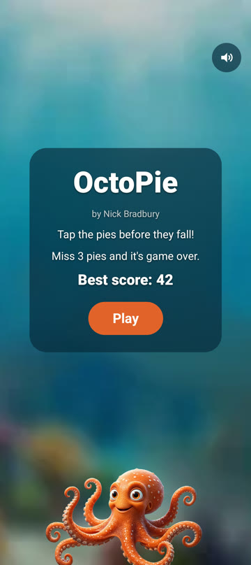
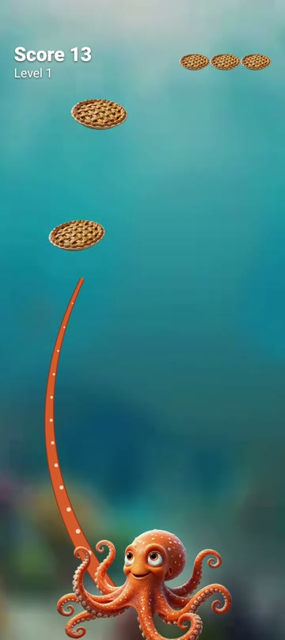
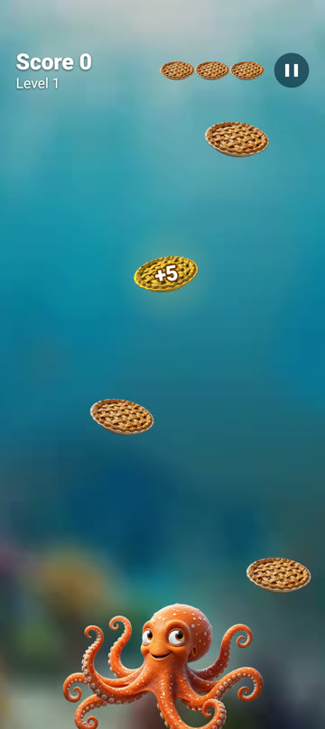
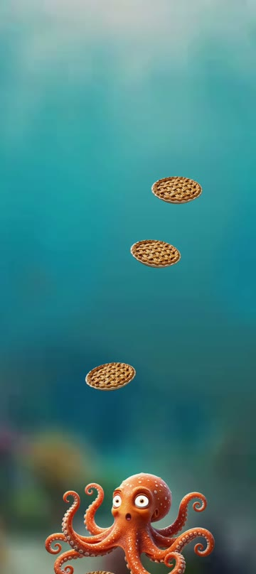
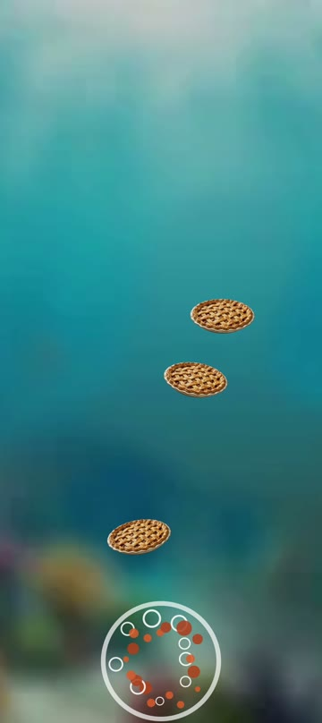

#  OctoPie

An Android arcade game: pies rain down through the reef, and you tap them so the octopus can whip out a tentacle and grab them before they fall off the screen. The pies come faster and in bigger bunches the longer you last. Miss three and the octopus pops.

<p>
  
  
  
  
  
</p>

## How to play

- Tap a falling pie and the octopus sends a tentacle after it. The tentacle chases the pie as it falls, reels it in, and the octopus gulps it down.
- Each pie caught is one point. Your best score is saved and shown on the start screen.
- About one pie in twelve is golden: it glows, carries a "+5" and is worth five points. Letting a golden pie fall costs nothing.
- Up to eight tentacles can be out at once.
- A regular pie that falls off the bottom costs a life; lose three and it's game over.
- Every 15 seconds the level goes up: pies fall faster, arrive more often, come in bursts, and the music speeds up.
- Pause with the button in the corner or with Back. The game also pauses by itself whenever the app loses focus, so a phone call never costs you a life.

## Features

- The octopus watches the closest pie, gently sways its arms, and reaches with a different arm each time.
- When the game is lost it looks surprised, puffs up and pops in a burst of bubbles.
- Swoosh, gulp and pop sound effects and background music.
- Haptics: a tick for each pie swallowed, a stronger click for a golden one, a buzz for a miss and a thump when the octopus pops.
- A sound toggle on the start, pause and game-over screens that silences vibration too.
- Full screen, portrait only.

## Building

Requires JDK 17+ and the Android SDK with platform 37. The app runs on Android 11 (API 30) and later.

```sh
./gradlew installDebug       # build and install on a connected device or emulator
./gradlew testDebugUnitTest  # run the game-engine tests
```

## Code

Kotlin and Jetpack Compose, with the game drawn on a single `Canvas` and driven by a `withFrameNanos` loop; no game engine.

| File | What it does |
|---|---|
| `game/GameEngine.kt` | The rules, in plain Kotlin with no Android dependencies: pies, tentacles, lives, levels, pausing and the octopus's gaze. It reports what happened each frame as `GameEvent`s, and `Difficulty` holds the tuning curves. |
| `game/GameScreen.kt` | The frame loop, touch handling, drawing order, the HUD and menu overlays, and the sounds and haptics played for each `GameEvent`. |
| `game/OctopusDrawing.kt` | The octopus: swaying arms (a bitmap mesh warp), eyes that follow the pies, and the surprised-and-pop game-over sequence. |
| `game/TentacleDrawing.kt` | Draws a reaching tentacle as a tapered, curling Bézier with suckers. |
| `game/GameSounds.kt`, `game/BackgroundMusic.kt` | Sound effects (`SoundPool`) and looping music (`MediaPlayer`) whose tempo follows the level. |

## Assets

The octopus and pie images were generated with Adobe Firefly. `tools/prepare_assets.py` turns the originals into the game's drawables: it cuts them out with [rembg](https://github.com/danielgatis/rembg), removes the octopus from its reef to make the blurred background, paints the irises out so the game can move them, and builds the surprised face. Cutting out the octopus needs about 11 GB of RAM.

The sound effects are synthesized from scratch by `tools/make_sounds.py`.

Both scripts run from a throwaway virtualenv:

```sh
python3 -m venv /tmp/octopie-venv
/tmp/octopie-venv/bin/pip install "rembg[cpu]" pillow numpy
/tmp/octopie-venv/bin/python tools/prepare_assets.py <octopus.png> <pie.png>
/tmp/octopie-venv/bin/python tools/make_sounds.py
```

Background music: "Sunlight Through the Blue".

## Credits

Created by Nick Bradbury.
